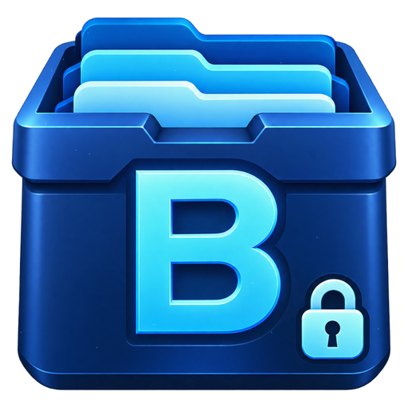

<div align="center">
  
  <h1>Beytarchiver v4.0.1</h1>
  <p><strong>Windows için Hepsi Bir Arada Arşivleme, Şifreli Kasa, Sistem Temizliği ve Telefona Dosya Aktarım Aracı</strong></p>
  <p>
    <a href="https://beytarchiver.github.io/">🌐 Resmi Web Sitesi</a> ·
    <a href="https://github.com/beytu2855/files/releases/latest">⬇️ Windows İçin İndir (v4.0.1)</a> ·
    <a href="#-kurulum-rehberi">📖 Kurulum Rehberi</a> ·
    <a href="#-english-installation-guide">🇬🇧 English Guide</a>
  </p>
</div>

---

## ✨ Öne Çıkan Özellikler

| Modül | Açıklama |
|---|---|
| 📦 **Sıkıştırma & Çıkartma** | `ZIP`, `7z`, `TAR`, `GZ` ve `.beyt` arşiv desteği. Sürükle-bırak, AES şifreli ZIP ve yol geçişi (`../`) saldırılarına karşı güvenli çıkartma. |
| 🔐 **Gizli Kasa (`.beyt`)** | Dosyalarınızı **AES-256-GCM** ve `scrypt` anahtar türetme ile şifrelenmiş tek bir kasa dosyasına dönüştürür. |
| 📱 **Telefonla Aktar (v4.0+)** | Aynı yerel ağdaki (Wi-Fi / Ethernet) Android telefonunuza QR eşleştirme, 6 haneli kod onayı, TLS şifrelemesi ve SHA-256 doğrulaması ile kablosuz dosya gönderin. |
| 🔑 **Şifre Yöneticisi** | Ana parola korumalı, cihazınızda yerel olarak (`~/.beyt_passwords.enc`) AES-256-GCM ile saklanan şifreli kasa. Sekmeden çıkınca otomatik kilitlenir. |
| 🧹 **Sistem Temizleyici** | Windows Temp, AppData Temp, önbellek ve Geri Dönüşüm Kutusu tarama ve onaylı temizleme. |
| 👥 **Çift Dosya Bulucu** | Önce boyuta göre gruplayıp yalnızca eşleşen adayların SHA-256 özetini hesaplayan hızlı kopya tarayıcı. |
| 📁 **Akıllı Düzenleyici** | Masaüstü ve İndirilenler klasörlerini dosya türlerine göre arka planda düzenler; mevcut dosyaların üzerine asla yazmaz. |
| 🔥 **Güvenli Dosya Silme** | Dosyanın üzerine 3 geçişli veri yazıp siler. |
| 📈 **Kaynak İzleyici & Araçlar** | Canlı CPU/RAM izleyici, MD5/SHA-1/SHA-256 Hash hesaplayıcı, Disk Analizi, Başlangıç Yöneticisi ve 11 renk teması. |

---

## 📖 Kurulum Rehberi

### 1️⃣ Windows Kurulum Sihirbazı ile Kurulum *(Önerilen — Son Kullanıcılar İçin)*

Python veya ek bir kütüphane kurmanıza **gerek yoktur**.

1. **[GitHub Releases](https://github.com/beytu2855/files/releases/latest)** sayfasına gidin.
2. **Assets** altından **`Beytarchiver_v4.0.1_Setup.exe`** dosyasını indirin.
3. İndirilen `.exe` dosyasına çift tıklayın.
   > 💡 **Windows SmartScreen Uyarısı Çıkarsa:** Uygulama yeni yayınlandığı için Windows Mavi Ekran uyarısı gösterebilir. Dosyayı resmi GitHub sayfasından indirdiyseniz **“Ek bilgi (More info)”** → **“Yine de çalıştır (Run anyway)”** düğmesine tıklayarak kuruluma devam edebilirsiniz.
4. Kurulum sihirbazında (Inno Setup) dilerseniz **“Masaüstü simgesi oluştur”** kutucuğunu işaretleyin ve **İleri → Kur** adımlarını tamamlayın.
5. Kurulum bittiğinde **Beytarchiver Pro** otomatik olarak açılır.

---

### 2️⃣ Android Telefona Kurulum ve Test Rehberi *(Alpha — v4.0.1)*

> 📄 **Detaylı Doküman:** [Android Kurulum ve Test Rehberi (`docs/android-install-and-test.md`)](docs/android-install-and-test.md)

Bilgisayardan Android telefona (Android 8.0 / API 26 ve üzeri) bulut kullanmadan, doğrudan yerel ağ üzerinden dosya göndermek için:

#### A) Android APK Kurulumu ve SHA-256 Doğrulaması
1. Depoda **[Actions → Android debug APK](https://github.com/beytu2855/files/actions)** sekmesini açın ve en son başarılı (yeşil) derlemeye tıklayın.
2. **Artifacts** bölümünden `beytarchiver-android-4.0.1-<commit>` ZIP paketini indirip açın.
3. ZIP içinde `Beytarchiver-4.0.1-debug.apk` ve `SHA256SUMS` dosyaları bulunur. İndirilen APK'nın SHA-256 bütünlüğünü doğrulamak için PowerShell'de:
   ```powershell
   Get-FileHash .\Beytarchiver-4.0.1-debug.apk -Algorithm SHA256
   ```
4. `Beytarchiver-4.0.1-debug.apk` dosyasını telefonunuza aktarın ve açarak kurun (tarayıcı/dosya yöneticisi için *“Bilinmeyen kaynaklardan uygulama yükleme”* iznini onaylayın).
   - *Not:* Bu APK debug anahtarıyla imzalanır. *“Paket mevcut uygulamayla çakışıyor”* hatası alırsanız önceki alpha sürümünü kaldırıp yeniden kurun.

#### B) Bilgisayardan Telefona İlk Aktarım Adımları
1. **Aynı Ağ:** Bilgisayarınızın ve telefonunuzun aynı yerel ağda (aynı Wi-Fi veya aynı modeme bağlı Ethernet) olduğundan emin olun. *(Misafir Wi-Fi veya açık VPN bağlantıyı engelleyebilir.)*
2. **Bağlantıyı Başlat:** Bilgisayarda Beytarchiver'ı açın → **📱 Telefonla Aktar** sekmesine geçin → ağ arabiriminizi seçip **Bağlantı Başlat** düğmesine tıklayın.
   - Windows Güvenlik Duvarı izin sorarsa yalnızca **Özel ağlar (Private networks)** kutucuğunu işaretleyip izin verin.
3. **QR Kodu Okutun:** Telefonda Beytarchiver uygulamasını açın → **QR Kodunu Tara** düğmesine dokunun ve bilgisayar ekranındaki QR kodunu okutun *(QR 120 saniyede bir yenilenir)*.
4. **6 Haneli Kodu Onaylayın:** Hem bilgisayar hem telefon ekranında **6 haneli bir eşleştirme kodu** belirecektir. İki ekrandaki kod birebir aynıysa bilgisayardan **Kodlar Aynı — Onayla** düğmesine tıklayın.
5. **Dosya Seçin ve Kaydedin:**
   - Bilgisayarda **Dosya Seç** düğmesiyle göndermek istediğiniz dosyayı (en fazla 1 GiB) seçin.
   - Telefonda **Al ve Kaydet** düğmesine dokunup dosyanın kaydedileceği klasörü seçin.
   - Aktarım boyunca telefon ekranını açık tutun. Dosya ulaştığında SHA-256 bütünlük doğrulaması otomatik yapılır ve bilgisayarda **Tamamlandı** bilgisi görünür.

#### C) Gerçek Cihaz Test ve Kabul Tablosu

| Kontrol | Sonuç |
| --- | --- |
| Telefon modeli, Android sürümü, Windows sürümü | Bekliyor |
| APK kurulumu, kamera izni / izin reddi ve QR tarama | Bekliyor |
| Kod karşılaştırması, Windows onayı / reddi | Bekliyor |
| Sıfır bayt ve en az 10 MiB dosya aktarımı | Bekliyor |
| Telefonda gösterilen SHA-256 ile `Get-FileHash` eşleşmesi | Bekliyor |
| Wi-Fi kopması, iptal ve arka plana geçiş | Bekliyor |
| Hedefte yetersiz alan ve kısmi dosya temizliği | Bekliyor |
| QR / onay / oturum süresinin dolması | Bekliyor |
| Sonraki alpha APK'yı kurma / imza farklılığı | Bekliyor |

👉 Daha ayrıntılı teknik bilgi için: [Android Kurulum ve Test Rehberi](docs/android-install-and-test.md)

---

### 3️⃣ Python Kaynak Kodundan Çalıştırma *(Geliştiriciler İçin)*

Uygulamayı doğrudan Python kaynak kodundan çalıştırmak veya geliştirmek isterseniz:

**Gereksinimler:**
- Windows 10 / 11 (64-bit)
- Python **3.10+** (Tkinter bileşeniyle birlikte)

```powershell
# 1. Depoyu klonlayın ve klasöre girin
git clone https://github.com/beytu2855/files.git
cd files

# 2. Sanal ortam (.venv) oluşturun ve bağımlılıkları yükleyin
python -m venv .venv
.\.venv\Scripts\python.exe -m pip install -r beytarchiver-requirements.txt

# 3. Uygulamayı başlatın
.\.venv\Scripts\python.exe ".\venv\Akıllı_Dosya_Yöneticisi\beytarchiver.py"
```

> ⚠️ **Not:** Depo içindeki `venv/Akıllı_Dosya_Yöneticisi` klasörü projenin kaynak kodlarını barındırır; kendi sanal ortamınız için `.venv` adını kullanın.

---

### 4️⃣ Korumalı `.exe` ve Kurulum Paketi Derleme *(Nuitka + PyInstaller + Inno Setup)*

Kaynak kodları C/makine koduna (`.pyd`) derleyip tek klasörlü `.exe` ve Inno Setup kurulum sihirbazı (`Beytarchiver_v4.0.1_Setup.exe`) üretmek için:

```powershell
# 1. Nuitka + PyInstaller ile korumalı dist\Beytarchiver\Beytarchiver.exe üretir
powershell -ExecutionPolicy Bypass -File .\build_windows.ps1

# 2. Inno Setup ile Output\Beytarchiver_v4.0.1_Setup.exe kurulum dosyasını derler
& "C:\Program Files\Inno Setup 7\ISCC.exe" .\setup_scriss.iss
```

---

## 🇬🇧 English Installation Guide

### 1. Install via Windows Setup Wizard *(Recommended)*
1. Go to **[GitHub Releases](https://github.com/beytu2855/files/releases/latest)** and download **`Beytarchiver_v4.0.1_Setup.exe`**.
2. Run the installer. If Windows SmartScreen appears, click **More info → Run anyway** (as long as you downloaded it from the official GitHub repository).
3. Follow the setup wizard steps and launch **Beytarchiver Pro**. You can switch the interface language to **EN** anytime from the **⚙️ Settings** tab.

### 2. Run from Source (Python 3.10+)
```powershell
git clone https://github.com/beytu2855/files.git
cd files
python -m venv .venv
.\.venv\Scripts\python.exe -m pip install -r beytarchiver-requirements.txt
.\.venv\Scripts\python.exe ".\venv\Akıllı_Dosya_Yöneticisi\beytarchiver.py"
```

---

## 🛡️ Güvenlik ve Şeffaflık Notları

- **Yerel Gizlilik:** Beytarchiver hiçbir veriyi buluta göndermez; şifreleriniz ve `.beyt` kasalarınız yalnızca bilgisayarınızda AES-256-GCM ile şifrelenmiş olarak tutulur.
- **Ana Parola Uyarısı:** Şifre Yöneticisi ve Gizli Kasa ana parolaları hiçbir yere kaydedilmez. Parolanızı unutursanız veriler kurtarılamaz.
- **Dosya Kontrolü:** Uygulama içindeki *Dosya Kontrolü* aracı yalnızca EICAR test imzasını ve gizlenmiş çift uzantıları kontrol eder; tam kapsamlı bir antivirüs yazılımının (ör. Windows Defender) yerini almaz.
- **Bellek Azaltıcı:** *Bellek Azalt* özelliği yalnızca Beytarchiver sürecinin kendi çalışma kümesini (`EmptyWorkingSet`) küçültür.
